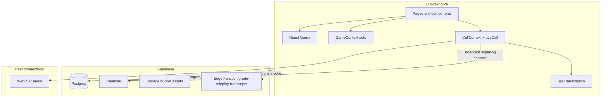

# Role Guessers — Engineering Handbook

Technical documentation, user-facing flows, API references, and practices for onboarding engineers. This project is a **Vite + React + TypeScript** web app (“Role Guessers”) with **Supabase** for multiplayer lobbies, **WebRTC** for voice, optional **LLM grading** via a Supabase Edge Function, and **Supabase Storage** for scenario assets.

---

## 1. Product overview

- **Multiplayer path**: Home → create/join lobby (`/lobby/:code`) → synchronized game phases in the lobby page → optional dedicated results view (`/game?code=...`).
- **Solo path** (`/solo`): Local-only game using `GameContext` and the same UI phases without Supabase.
- **Scenarios**: Toxic Workplace (primary); additional scenario families exist in types (`cultscenarios`, `familyscenarios`) but may be gated in the UI.

For narrative “how to play,” see the repository root [`README.md`](../README.md).

---

## 2. Architecture

### 2.1 High-level diagram



### 2.2 Responsibilities by layer

| Layer | Role |
|--------|------|
| **Pages** | Routing, composing feature components, orchestrating lobby/game lifecycle. |
| **Feature components** | `RoleReveal`, `RoleplayTimer`, `GuessingPhase`, `Results`, `LobbyWaiting`, `ScenarioEditor`, etc. |
| **`src/components/ui/`** | shadcn/ui primitives (Radix + Tailwind); treat as design system building blocks. |
| **Contexts** | `GameContext` (solo state machine); `CallContext` (voice + transcription accessors for lobby gameplay). |
| **Hooks** | `useLobby`, `useCall`, `useTranscription`, `useScenarios`, `useS3Upload`, `useScenarioAssets`, etc. |
| **`src/lib/`** | Pure helpers (`scenarioBundle`, `mergeTranscriptionEntries`, `webrtc-config`, `utils`). |
| **`src/llm/`** | Payload preparation and invocation of the grading Edge Function. |
| **Supabase** | Authoritative lobby and player rows, realtime subscriptions, storage, and server-side grading entry point. |

### 2.3 Data flow (multiplayer)

1. **`useLobby`** loads `lobbies` and `lobby_players` and subscribes to Realtime `postgres_changes` on those tables (filtered by lobby code / refetch on player changes).
2. **Game phase** is driven by updates to `lobbies.current_phase` and related fields (host actions and timers in `Lobby.tsx`).
3. **Voice**: `useCall` opens `RTCPeerConnection`s to other players and exchanges offers/answers/ICE over a **Supabase Realtime channel** (not Postgres events).
4. **Transcripts**: During roleplay, `useTranscription` captures local speech; the lobby page merges and **persists transcripts to `lobby_players.transcripts`** on an interval and when leaving roleplay.
5. **Grading**: After roleplay, `prepareTranscriptsForGrading` builds a payload; `gradeRoleplayTranscripts` calls the Edge Function `grade-roleplay-transcripts`. Scores/summaries are merged into UI state (see `Lobby.tsx` / `Game.tsx`).

---

## 3. Repository map

| Path | Purpose |
|------|---------|
| `src/App.tsx` | Router, global header, toasts, `SpeechRecognitionBrowserBanner`. |
| `src/pages/` | Route screens: `LobbyEntry`, `Lobby`, `Game`, `Index` (solo), `TutorialPage`, `NotFound`, static marketing (`AboutPage`, `ContactUs`). |
| `src/components/` | Game and lobby features; `ui/` = shadcn. |
| `src/hooks/` | Data and side-effect hooks (lobby, call, transcription, scenarios, uploads). |
| `src/contexts/` | `GameProvider` / `CallProvider`. |
| `src/types/` | `game`, `lobby`, `call`, `scenario`, scenario packs. |
| `src/integrations/supabase/` | Generated `client.ts`, `types.ts` — **do not hand-edit `client.ts`** (comment in file). |
| `src/llm/` | Grading client and transcript shaping. |
| `src/lib/scenarioBundle.ts` | JSON bundle format for import/export of scenarios (`fia-scenario-bundle`, version 2). |
| [`CALL_AND_TRANSCRIPTION.md`](./CALL_AND_TRANSCRIPTION.md) | WebRTC + speech. |
| [`SCENARIO_MANAGER.md`](./SCENARIO_MANAGER.md) | Scenario editor, storage layout, asset UX. |

Path alias: `@/` → `src/` (see `vite.config.ts` and `tsconfig`).

---

## 4. Routing

Defined in [`src/App.tsx`](../src/App.tsx):

| Route | Screen |
|-------|--------|
| `/` | `LobbyEntry` — create/join Toxic Workplace, open scenario editor. |
| `/solo` | `Index` — offline game with `GameProvider`. |
| `/lobby/:code` | `Lobby` — full multiplayer session + call + transcription. |
| `/game` | `Game` — expects `?code=` query; loads lobby state for results-oriented view. |
| `/tutorial`, `/about`, `/contact` | Marketing / help. |
| `*` | `NotFound`. |

---

## 5. APIs and external interfaces

### 5.1 Supabase (primary backend)

**Client**: [`src/integrations/supabase/client.ts`](../src/integrations/supabase/client.ts) — `createClient` with `Database` typing from [`types.ts`](../src/integrations/supabase/types.ts).

**Usage patterns**:

- **Tables**: `lobbies`, `lobby_players`, `scenarios`, `scenario_roles` (and related fields per generated types).
- **RPC**: e.g. `generate_lobby_code` (see `useLobby.ts`).
- **Realtime**: `supabase.channel(...).on('postgres_changes', ...)` for lobby sync; separate channels for WebRTC signaling in `useCall.ts`.
- **Storage**: bucket **`assets`** — public URLs for uploaded media; paths often scoped per scenario (see [SCENARIO_MANAGER.md](./SCENARIO_MANAGER.md)).
- **Edge Functions**: `supabase.functions.invoke('grade-roleplay-transcripts', { body })` from [`gradeRoleplayTranscripts.ts`](../src/llm/gradeRoleplayTranscripts.ts).

**Engineering note**: Row Level Security (RLS), policies, and the Edge Function implementation live in the Supabase project, not in this repo. New engineers need dashboard access or exported migrations to reproduce the backend.

### 5.2 WebRTC and browser media

- **ICE**: [`src/lib/webrtc-config.ts`](../src/lib/webrtc-config.ts) — STUN (`stun:stun.l.google.com:19302`) and optional TURN from env vars.
- **APIs**: `getUserMedia`, `RTCPeerConnection`, `RTCDataChannel` (see `useCall.ts`).
- **Signaling**: Custom messages over Supabase Realtime channels (not HTTP).

### 5.3 Web Speech API

- **`webkitSpeechRecognition`** (and variants) via [`useTranscription.ts`](../src/hooks/useTranscription.ts) and [`speechRecognitionSupport.ts`](../src/lib/speechRecognitionSupport.ts).
- **No API keys** in the browser path; quality and availability depend on the user’s browser/OS.

### 5.4 Optional / ancillary HTTP

- **Asset HEAD/check**: [`useScenarioAssets.ts`](../src/hooks/useScenarioAssets.ts) may `fetch` public storage URLs to validate assets.

### 5.5 LLM grading contract (client side)

- **Entry**: `gradeRoleplayTranscripts` → Edge Function response typed as `RoleplayGradingResult` in [`gradeRoleplayTranscripts.ts`](../src/llm/gradeRoleplayTranscripts.ts).
- **Payload**: Built by [`prepareTranscriptsForGrading.ts`](../src/llm/prepareTranscriptsForGrading.ts).

---

## 6. Environment variables

| Variable | Required | Purpose |
|----------|----------|---------|
| `VITE_SUPABASE_URL` | Yes | Supabase project URL. |
| `VITE_SUPABASE_PUBLISHABLE_KEY` | Yes | Anon/public client key. |
| `VITE_SUPABASE_PROJECT_ID` | Optional | Documented in `vite-env.d.ts`; use if tooling needs project id. |
| `VITE_TURN_URL`, `VITE_TURN_USERNAME`, `VITE_TURN_CREDENTIAL` | Optional | TURN for restrictive networks (WebRTC). |
| `VITE_LLM_ROLE_SCORE_WEIGHT` | Optional | Used in [`Lobby.tsx`](../src/pages/Lobby.tsx) when applying LLM role scores (defaults to `1` if unset). |

Add new `VITE_*` variables to [`src/vite-env.d.ts`](../src/vite-env.d.ts) for TypeScript awareness.

---

## 7. Component and feature index

### 7.1 Game flow (shared concepts)

| Component | Responsibility |
|-----------|----------------|
| `GameSetup` | Solo setup (player count, scenario). |
| `RoleSelection` | Ranked role choices where applicable (lobby). |
| `RoleReveal` | Secret role display. |
| `RoleplayTimer` | Countdown / phase advance for roleplay. |
| `AssetSelector` | Pick stored asset to show to everyone. |
| `GuessingPhase` | Collect guesses vs other players’ roles. |
| `Results` | Scores and reveals. |
| `LobbyWaiting` | Pre-start lobby UI. |

### 7.2 Infrastructure UI

| Component / hook | Responsibility |
|------------------|----------------|
| `SpeechRecognitionBrowserBanner` | Warns when speech APIs are unsupported. |
| `ScenarioEditor` | Edit scenarios, manage DB + storage assets (see [SCENARIO_MANAGER.md](./SCENARIO_MANAGER.md)). |
| `useLobby` | CRUD + realtime for lobbies/players. |
| `CallProvider` / `useCallContext` | Mute, speaking indicators, transcript accessors. |

### 7.3 shadcn/ui (`src/components/ui/`)

Primitives (Button, Card, Dialog, Form, etc.) built from **Radix UI** primitives and **Tailwind**. Customize via `tailwind.config.ts` and `src/index.css`. New UI should compose these before adding one-off styles.

---

## 8. User guide (condensed)

### 8.1 Local development

```bash
npm install
npm run dev
```

Default Vite dev server is configured for **port 8080** and host `::` (see `vite.config.ts`).

### 8.2 Production build

```bash
npm run build
npm run preview   # optional local verification
```

### 8.3 Playing (multiplayer)

1. Open `/`, choose Toxic Workplace, create or join with a code.
2. Host selects scenario and starts when ready; players join the same code.
3. Complete phases in order (waiting → role assignment → roleplay with optional voice/assets → guessing → results).
4. Ensure **microphone permission** for voice; use a **supported browser** for transcription banner guidance.

### 8.4 Scenario editor and assets

See [SCENARIO_MANAGER.md](./SCENARIO_MANAGER.md): open editor from the Toxic Workplace card, upload to the `assets` bucket, use **Select Asset** during roleplay.

---

## 9. Best practices for engineers

1. **Supabase types**: After schema changes, regenerate or update `src/integrations/supabase/types.ts` so PostgREST calls stay type-safe.
2. **Realtime subscriptions**: Always remove channels on unmount (`useLobby`, `useCall` patterns) to avoid leaks and duplicate handlers.
3. **WebRTC**: Expect autoplay restrictions; the app resumes audio after user gestures — do not remove that UX without testing Chrome/Safari/Firefox.
4. **Transcripts**: Merging logic must preserve server + local lines (`mergeTranscriptionEntries`); avoid blind overwrites to `lobby_players.transcripts`.
5. **Secrets**: Never put service keys in the SPA; use Edge Functions or server-side code for privileged operations.
6. **Solo vs multiplayer**: Reuse components that expect `LobbyPlayer[]`; adapters live in `Index.tsx` for solo mode — keep field shapes aligned when changing types.
7. **Bundled scenarios**: Import/export uses [`scenarioBundle.ts`](../src/lib/scenarioBundle.ts); bump `SCENARIO_BUNDLE_VERSION` when the JSON contract changes and document migrations.
8. **Lint**: `npm run lint` before merge; keep `eslint` clean for touched files.

---

## 10. Handoff checklist

- [ ] Supabase project access (tables, RLS, Storage bucket `assets`, Edge Function `grade-roleplay-transcripts`).
- [ ] `.env` populated with `VITE_SUPABASE_*` (and TURN if production voice quality requires it).
- [ ] Read [CALL_AND_TRANSCRIPTION.md](./CALL_AND_TRANSCRIPTION.md) for voice + transcript behavior.
- [ ] Read [SCENARIO_MANAGER.md](./SCENARIO_MANAGER.md) for asset pipeline.
- [ ] Run `npm run build` and smoke-test `/`, `/lobby/:code`, and `/solo`.

---

## 11. Related documentation

| Document | Topics |
|----------|--------|
| [`README.md`](../README.md) | Feature list, install, player-facing description (root; GitHub default). |
| [`CALL_AND_TRANSCRIPTION.md`](./CALL_AND_TRANSCRIPTION.md) | WebRTC, Speech Recognition, env vars, file locations. |
| [`SCENARIO_MANAGER.md`](./SCENARIO_MANAGER.md) | Scenario editor UX, S3/Storage layout, troubleshooting. |

---

*This handbook reflects the repository layout at handoff time. Update it when architecture, env vars, or external services change.*
